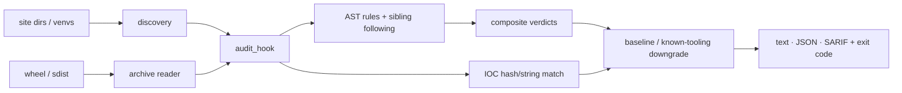

# pthguard

[](https://github.com/Nithinfgs/pthguard/actions/workflows/ci.yml)
[](LICENSE)


**Audit the code Python runs before your code runs.**
`pthguard` finds and analyzes Python *startup hooks*: `.pth` files, `sitecustomize.py` and
`usercustomize.py`. These execute in **every** Python process on the machine, with no `import`
from you. It scans installed environments and inspects wheels/sdists *before* you install them.

## Why

On 2026-10-21, `litellm==1.107.0` on PyPI was found to ship a credential stealer and a
background backdoor. It had no `setup.py` hook or postinstall script. It dropped `cook.pth`
(`import cook`) and `sitecustomize.py` into `site-packages`, so the payload ran in every Python
process on the host ([SafeDep analysis](https://safedep.io/litellm-pypi-compromise-credential-stealer-backdoor/)).
Most package scanners look at `setup.py` and import-time code of the package itself; few look at
what the package *drops next to* site-packages. MITRE tracks the technique as
[T1546.018](https://attack.mitre.org/techniques/T1546/018); the common advice is "baseline your
hook files", but my searches turned up only SIEM rules (e.g. Elastic) and no standalone open-source scanner. pthguard fills that gap.

## What it does

| Capability | Detail |
|---|---|
| Finds hooks | `*.pth`, `sitecustomize.py`, `usercustomize.py` in the running interpreter's site dirs, explicit `--path`s, or every virtualenv under `--venv-root` |
| Executes nothing | Static AST analysis only. Archives are read in memory, never extracted or imported |
| Follows imports | `import cook` in a `.pth` → analyzes `cook.py` next to it (up to 3 levels) |
| Capability rules | exec/eval, decoding blobs, network modules, process spawn, fork/setsid/daemon, env enumeration, credential paths (`.ssh`, `.aws`, `.kube`, `169.254.169.254`, ...), high-entropy literals, world-writable `sys.path` entries |
| Composite verdicts | network + credential access ⇒ **stealer**; detach + network/exec ⇒ **backdoor**; fetch + decode/exec ⇒ **loader** |
| Known-bad IOCs | SHA-256 and string indicators of the LiteLLM 1.107.0 compromise, plus `/tmp` host markers; extend with `--iocs file.json` |
| Pre-install gate | `pthguard check *.whl` / sdists, counting only files that land on `sys.path` |
| Baseline (TOFU) | `pthguard baseline` records hook hashes; later scans flag **new** and **changed** hooks |
| Ownership | Maps hooks to the installing distribution via `RECORD`; unowned hooks get flagged |
| CI-friendly | `--format json` / `sarif`, `--fail-on LEVEL`, exit codes 0 / 1 / 2 |



## Install

```bash
pip install git+https://github.com/Nithinfgs/pthguard.git
# or from a checkout
pip install -e .
```

Requires Python 3.10+. No runtime dependencies.

## Quick start

```bash
# audit the environment pthguard is installed in
pthguard scan

# audit every virtualenv under your projects folder
pthguard scan --no-default --venv-root ~/projects

# gate an install: download first, inspect, then install
pip download some-package --no-deps -d /tmp/dl
pthguard check /tmp/dl && pip install /tmp/dl/*.whl

# trust what is there today, alert on anything new or changed
pthguard baseline hooks.json
pthguard scan --baseline hooks.json --fail-on medium
```

### Try it against an inert demo attack

```bash
python examples/make_demo_wheel.py /tmp/pg-demo   # writes an unexecuted lookalike wheel
pthguard check /tmp/pg-demo
```

Output (abridged; exit code 1):

```text
CRITICAL innocent_helper-1.0.0-py3-none-any.whl:demo.pth
   CRITICAL PTH-STEALER   network access combined with credential-file access (stealer pattern)
   CRITICAL PTH-BACKDOOR  detached background task with network/exec capability (backdoor pattern)
   HIGH     PTH-CRED      references sensitive location '.ssh'  (demo_payload.py:4)
   MEDIUM   PTH-NET       imports network module 'urllib'  (demo_payload.py:1)
   LOW      PTH-SIBLING   startup code imports 'demo_payload' from the same directory  (demo.pth)
```

The demo wheel is never installed and its payload function is never called.

## Reference

`pthguard scan` · `--path DIR` · `--venv-root DIR` · `--no-default` · `--baseline FILE` ·
`--no-host-markers` · `--format text|json|sarif` · `--fail-on info|low|medium|high|critical|none`
(default `high`) · `-v` · `--iocs FILE`

`pthguard check ARCHIVE_OR_DIR...` · `.whl`, `.zip`, `.tar.gz`, `.tgz`

`pthguard baseline OUTPUT` · same discovery flags as `scan`

Exit codes: `0` nothing at/above `--fail-on`; `1` findings; `2` usage or I/O error.

Custom IOC file schema: see [`src/pthguard/iocs.json`](src/pthguard/iocs.json).

## Configuration

There are no config files or environment variables. Everything is a flag. `.env.example` is
intentionally absent.

## Testing

```bash
pip install -e ".[dev]"
pytest -q && ruff check . && ruff format --check . && mypy
```

## Limitations

- **Static analysis can be evaded.** Heavily obfuscated payloads, code fetched at runtime, or
  hooks that import from outside the same directory are only partly visible. pthguard raises
  flags on decoding/exec/high-entropy patterns, but a clean report is not proof of safety.
- Only same-directory imports from a hook are followed; compiled extensions (`.so`) are not analyzed.
- The built-in IOC list covers one campaign and is only as good as its public source.
- Heuristics can false-positive on legitimate tooling. Unknown editable-install and namespace
  hooks are common; use a baseline to accept them. Names like `distutils-precedence.pth` are only
  downgraded for MEDIUM-or-lower findings, so they cannot hide a stealer.
- Tested on macOS with Python 3.12, 3.13 and 3.14. Linux/Windows path handling is not locally
  verified; CI covers Linux and macOS on 3.10 to 3.13.
- It does not look at `*.egg-link`, `usercustomize` outside site dirs on `sys.path`, or
  `PYTHONSTARTUP`/`PYTHONPATH` environment injection.

## Roadmap

1. Query OSV/PyPI advisories for the owning distribution of each hook.
2. `sys.path`-wide `sitecustomize` discovery and `PYTHONSTARTUP` / `PYTHONPATH` checks.
3. Rule suppression file with reasons and expiry.
4. Windows verification and `pre-commit` hook.
5. Optional runtime guard using `sys.addaudithook` during `pip install`.

## Contributing

See [CONTRIBUTING.md](CONTRIBUTING.md). Fixtures must be inert.

## License

[MIT](LICENSE)
